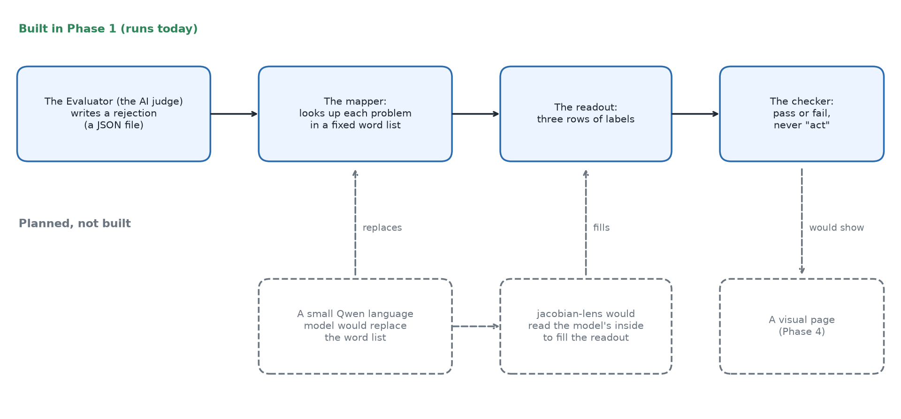
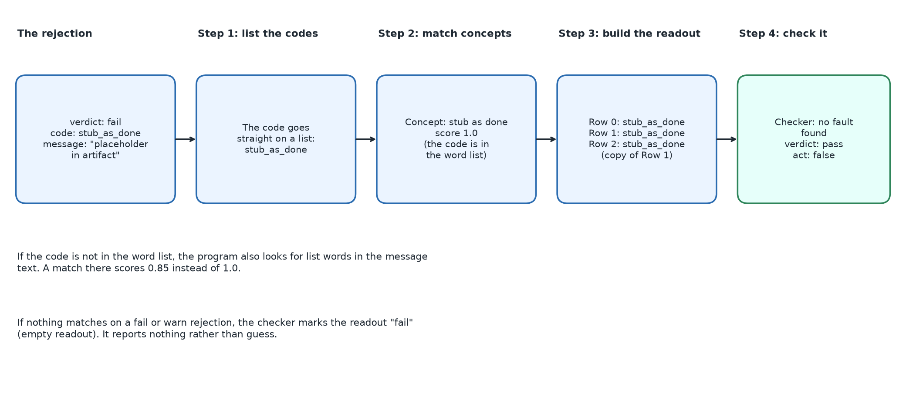
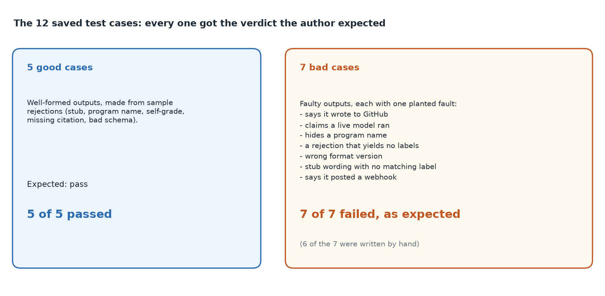

# meridian-jspace

*A small JavaScript program that takes the written reasons an AI judge gave for rejecting some work and turns them into a short list of plain concept labels, so a person can see why the rejection happened. It is a first, simplified step toward a much bigger idea that does not exist yet.*

Status: Phase 1 of six planned phases, last functional change 1 September 2026, last edit (to the README) 28 September 2026. Code: https://github.com/PCSchmidt/meridian-jspace (public, MIT licence, a permissive open-source licence). It has no stars, no forks and no users that I can show. Nothing is hosted.

## What it is

Meridian is a sibling project of mine that puts checkpoints around an AI coding agent. A checkpoint is called a gate: a stop sign that cannot be passed by claiming it was passed, because a small program has to confirm it. For some gates, a separate AI agent called the Evaluator scores the work, since an agent that grades its own work tends to be generous. When the Evaluator refuses something, it writes a rejection: a short record saying "fail" with a list of problems.

Reading that record tells you what the Evaluator complained about, but not what kind of failure it was. Was the agent pretending a half-finished piece was done? Did it grade its own work? Did it leave out a required file? meridian-jspace reads a rejection and prints a short list of labels such as "stub as done" or "self grade", with a score beside each. This output is called the readout. It then runs a few fixed checks on the readout and marks it "pass" or "fail". It also always prints "act: false", which means the program only reports. It never recommends or takes an action.

The name comes from the plan. I say the idea came from an Anthropic research page, "A global workspace in language models" (https://www.anthropic.com/research/global-workspace), which describes a small set of patterns inside a language model that works like a shared workspace. I have not said why the project is called J-space, and how to describe "J-space" here is undecided. "J-space" is the project's name for a readout drawn from inside a language model, using jacobian-lens, an Apache-2.0 licensed interpretability tool from Anthropic (interpretability is the study of what goes on inside a model) that the README links to. The model would be a small Qwen, one of a family of open-weight language models, meaning their files are freely published and can be run on a laptop. None of that exists yet. What exists today is a "mechanical" stand-in: a fixed word list, no machine-learning model at all. About 180 lines of JavaScript look each reported problem up in the list and print the matching labels.

Three caveats matter, and this is the only place they are stated in full:

- **No model, no real verdicts.** It uses no machine-learning model, and it has never been run on a real Evaluator verdict. The reason is a field-name mismatch. The shared specification repository my projects use, called portfolio-kit, says each problem in a verdict has fields named `artifact`, `severity` and `description`. The program looks for fields named `code` and `message`, which that format does not have. On a verdict written the official way it mostly finds nothing, or falls back on its weaker word matching. The README does not mention this.
- **Its tests are self-made.** The 7 tests and 12 saved test cases all pass, but they were written alongside the program, and six of the seven "bad" cases are hand-written faulty outputs, not real Evaluator output.
- **AI wrote the code.** AI coding agents wrote almost all of it. I do not recall what I decided beyond the written README and contract (the five concepts, the scores, the seven checker rules and the never-act rule).

A calculator gives the same answer for the same input every time; a weather forecast is a best guess that can be wrong. Everything in this repository is a calculator. The forecast part sits just outside it: the Evaluator is an AI model whose opinions can be wrong, and the planned later phases would add a language model.



If you have ten minutes, read this opening, "What it does today", "Does it work?" and "Strengths, shortcomings and the work still to do".

## What problem this solves

A person looking at a blocked gate sees a score, a verdict and a list of problems in free text, and has to read them to learn what went wrong. A short list of standard labels would let them scan faster and compare rejections over time. The README says it more broadly: a readout of the rejections "so a human can see why a gate fired". It calls the project "the research-adjacent differentiator in the family" (the family being my set of related projects), "not a replacement for the harness" (the harness being Meridian's checkpoint machinery). The repository does not record why it was started; I say the idea came from the Anthropic page named above. Without it, a person reads the free-text list. The repository does not compare itself with other tools.

The README sets out six phases. Phase 1, the mechanical version, is the only one built. The others are: instrumenting the Evaluator's reject path with a small open model (Phase 2), mapping rejection reasons into the model's own concepts (3), a simple visual page (4), experiments that inject deliberately bad outputs to see whether the readout notices (5), and a short technical note (6). Success has been measured only for Phase 1.

The scope is written down. The program must not post to GitHub, must not send a webhook (an automatic message from one program to another web service), must not download or run the model, and must use only public or made-up data. The contract also rules out Phases 4 and 5 for now and a related red-team project, which would try to attack the system.

## What it does today

Here is one example from start to finish, using the sample file the repository ships. It is a rejection, as a JSON file (JavaScript Object Notation, a plain-text format for structured data), with a verdict of "fail" and one problem. The problem has a severity of "high", a code of `stub_as_done`, and a message, "placeholder in artifact". The code is a short name for a kind of failure. Here it means a stub (a placeholder standing in for real work) was reported as if it were finished.

The program works in four steps:

1. **List the codes.** It lists every problem code as it stands.
2. **Match concepts.** It checks the codes against a fixed list of five concepts. `stub_as_done` is on the list, so the concept "stub as done" is reported with a score of 1.0.
3. **Build the readout.** The readout has three rows. The README calls them "layers" (layer 0 for the issues, layer 1 for the concepts, layer 2 for the "verbalizable" words, meaning concepts expressed in words), because the planned version would read the layers of a neural network. Here the layers are not real: they are three lists built from the same data. Row 0 simply lists the codes, each with a fixed 1.0 that means nothing. Row 2 is always a copy of row 1, because there are only five concepts and row 1 takes up to eight while row 2 takes up to five. Treat the rows as decoration that matches the planned shape.
4. **Check it.** The checker looks for signs of trouble and, finding none, marks the readout "pass" and writes "act: false".

A run printed exactly that: three rows, each holding the single label `stub_as_done`, a verdict of "pass", and "act: false".



The "pass" does not mean the rejection was right. It means the readout is well formed and consistent. A rejection the Evaluator got wrong would still give a "pass" readout. I cannot yet explain this unaided.

A mailroom clerk is a fair comparison: the clerk stamps each incoming complaint letter with a category from a printed list and does not judge whether the complaint is fair. It breaks down because the clerk understands the letter, while the program matches words and can be fooled by words that merely appear in the text.

The user is a developer running it from the command line (typing commands in a terminal) and reading the JSON it prints. There is no screen.

## How it works: parts, data and tools

The repository is small: a word list, one file holding the mapper and checker, a command-line entry point, two test files, a script that scores the saved cases, and documents (the README, a contract, a spec, a status note, an instruction file for AI agents and a gate list). The agents' instruction file says to keep the output's field names stable, to use only public or synthetic data and to run the tests after any change.

The program runs on Node.js (a way to run JavaScript outside a web browser), version 20 or later. It has no outside libraries, makes no network calls and needs no graphics card, and it runs in a fraction of a second.

The data is as small as the program: twelve made-up test cases and one sample rejection, none from a real Meridian run. The word list includes the names of defense programs and markings (F-35, JPO, ITAR, CUI and the word "classified"), but as words to catch, not as program data. Nothing is stored between runs.

## The methods

There are three methods, all simple.

**Matching problems to concepts.** The word list has five concepts. Each has a few issue codes and a few words attached.

| Concept | Issue codes that trigger it | Sample words that also trigger it |
| --- | --- | --- |
| stub as done | stub_as_done | TODO, TBD, placeholder, coming soon |
| self grade | self_grade, self_grade_contamination | generator_self_score, self-score |
| missing artifact | missing_id, missing_rule, missing_citation, missing_artifact | the same four names |
| extra entity | extra_entity | F-35, JPO, ITAR, CUI, classified, employer inventory |
| bad schema | bad_schema | bad_schema, schema mismatch |

A "schema" here means a written description of what shape a record should have. The matching has two tiers. If a problem's code is in the concept's code list, the concept scores 1.0. If no code matches but one of the sample words appears anywhere in the rejection text, the concept scores 0.85. If neither matches, the concept is dropped. Take a toy example: a rejection with the code `weird` and the message "result TBD". The code is on no list, but "TBD" is a sample word, so "stub as done" is reported at 0.85. A rejection with the code `weird` and the message "bad thing" matches nothing. The 1.0 and 0.85 are fixed numbers someone chose. They rank a direct code match above a word match, are not probabilities, and nothing in the repository says why 0.85.

**Checking the readout.** The checker runs seven fixed rules and marks the readout "fail" if any triggers: the format version string must be exactly `meridian-jspace.readout.v1`; the readout must not say it wrote to GitHub, posted comments or opened issues; it must not say it posted a webhook; it must not say a live model ran; stub words in the readout need a matching "stub as done" concept; program names need an "extra entity" concept; and a failed or warned rejection must produce at least one concept. The "act" value is then set to false whatever else happened. It is written as a constant in the checker, so a test confirming "a rejection never acts" confirms the value of a constant, not a decision.

**Refusing outright.** Separately, the program refuses to run at all if given options (flags, the extra words typed after a command) that ask it to write to GitHub (`--github-write`, `--comment`, `--issue`) or to use a live model (`--qwen`, `--download-model`, `--jacobian-lens`). It stops with an error rather than quietly skipping the request, and the same options passed from code do the same. The code that would write to GitHub or load a model does not exist, so the refusal is the whole behaviour.

## The models

This project uses no machine-learning model today. The chapter that would be the longest in a model project is a plan.

The README names Qwen and jacobian-lens, introduced above, for Phase 2. It says only "a small Qwen checkpoint" (one saved version of the model) and does not pick one. A code comment calls the mechanical mapping "analogous to jacobian-lens unembedding", but the repository does not explain what jacobian-lens computes, and this guide does not describe it from memory. I am unsure whether I understand the planned goal well enough to explain it, so what the guide should say about it is open. Phase 1 imitates the shape of the output, not the method. Nothing here looks inside a model, and whether the planned J-space readout would show anything useful about a rejection is untested. Phase 5 is meant to test exactly that question: whether the readout truthfully reflects what the model is doing. Until then, the refusal rules are the only safeguard that applies to the planned parts.

## Edge cases, testing and safeguards

There are 7 tests, in two files, using Node's built-in test runner. They pass. The "eval" is a script that runs the 12 saved cases and prints results as JSON. The CI (continuous integration, an automatic run of the checks on every change) runs the tests and the eval on Node 20 on every push to the main branch and on pull requests. Both runs on file passed, in 11 and 15 seconds. There is no formatter, linter or coverage figure.

Several unusual inputs were tried for this guide, using throwaway calls that wrote nothing into the repository:

- A "fail" rejection with a code not on the list and no sample word produced a "fail" readout (empty readout), not a guess. That is intended.
- Words match as pieces of other words. "military style report" triggered "extra entity" because it contains "itar", and "data is unclassified" triggered it because it contains "classified". Both scored 0.85: false alarms.
- A rejection that is empty or missing entirely produced "pass", because the empty-readout rule applies only to a verdict of "fail" or "warn".
- A problem list that is a plain string instead of a list crashed the program with a JavaScript error.
- Options asking for a GitHub write or a live model threw the intended refusal every time, from the command line and from code.
- A verdict shaped as portfolio-kit describes was not read correctly, covered under the first shortcoming below.

Nothing tests very long text, odd characters or hostile input beyond the refusals. The program reads one local file the user names, and nothing else.

## Does it work? The results

The saved cases are the only measurement: five well-formed outputs that should pass and seven faulty ones that should fail. All 12 got the expected verdict. In the repository's terms, the "gate catch rate" (the share of known-bad cases that get stopped) is 1.0 on 7 cases, verdict agreement (the share of cases where the verdict matched the expected one) is 1.0 on 12, and known-bad cases never "act" in 7 of 7. The README's family scoring template, called "D3", sets a target of 0.85 for the catch rate. A re-run of the tests and the eval gave the same numbers as the status note.



Here is how much weight those numbers can bear. A gate that fails everything would also catch all 7 bad cases, so the catch rate alone proves little. The agreement figure is the check on that: the always-fail gate would score only 7 of 12 (about 0.58). Seven cases is also a small sample. A perfect 7 of 7 is still consistent with a true catch rate as low as about 65 in 100 (a standard one-sided calculation at 95% confidence: 0.05 to the power of one seventh is 0.652; a two-sided interval would reach lower, about 59). The eval files call the cases "held-out", which normally means kept hidden while the checker was built. These were written in the same commit as the checker, and no sign shows they were hidden. So the figures say "the checker's rules fire on cases written to trigger them". They do not say the readout is informative, or that the checker would catch faults nobody thought of. Nothing has been measured about whether the labels help a person: there was no baseline reader, no comparison with just reading the rejection, and no user.

## Could it be put into real use?

No, not as it stands. On a scale of experiment, works locally, deployable and operated, it sits between the first two: it runs on a laptop and passes its own checks in CI, but only on made-up inputs. It has no logging, no monitoring, no sign-in and no real data. The gap to a deployable version is mostly one item: read the shape of a real verdict, then show it working on real rejections. What resembles production practice is small: the refusals, and a CI check that fails if the saved cases stop agreeing.

## Strengths, shortcomings and the work still to do

The strengths are modest and checkable. The README now says plainly what is built and what is planned. There are no dependencies and it runs fast. The refusals are real code that the tests exercise.

Four shortcomings matter, in order.

**1. The program has not been shown to work on a real verdict.** The field names are the cause (see "What it is"). A test call with a verdict shaped as portfolio-kit's schema requires (its own example file lists no problems, so I added one), with a problem described as "Tests were not run before the feature was marked complete", gave no concepts and a failed, empty readout. With a description that happened to contain "TODO placeholders" it found "stub as done" at 0.85 by word match, and row 0 listed the problem as "unknown". I am unsure what real Evaluator rejections look like, including whether they carry issue codes, and I do not think I have saved any real rejections. There are two fixes: read the real fields (small effort, and it makes the project work on real data) or add codes to the shared format (larger, because it changes a contract other projects rely on). The first is better, with a test that reads the example file from portfolio-kit.

**2. The word matching is too loose.** It looks for pieces inside words, so "military" and "unclassified" trigger the wrong concept. Matching whole words fixes it with a few lines. Smaller robustness gaps sit here too: a non-list problem field crashes the program, and an empty rejection passes silently.

**3. The measurements are thin.** Seven bad cases written alongside the checker, no real rejections, and a gate whose "act" value is a constant. A set of real or realistically messy rejections, scored by a person, would show whether the labels are right. The contract's data-policy search is also not automated.

**4. The layers are decoration**, as described above, and should be read that way.

On completeness, one phase of six is built. The status note's own next step is Phase 2, with the instruction not to start the red-team project. I probably do not consider Phase 1 finished. Which later phases I want and how much time to give them are not chosen. The second commit's message reads "Note family pause; stay on Phase 0. Not the resume default." Whether to fix the field-name mismatch and the word matching before Phase 2 is left to a recommendation, not decided.

## How it was built, and who did what

The repository has four commits between 19 August and 28 September 2026. Only the last, the README edit, carries an AI co-author credit; the other three carry none, and the first commit used a placeholder email; I say my own account email was intended, and whether to rewrite history is not decided. So the history does not say which tool wrote the Phase 1 code. The instruction file for AI agents sets the do and do-not rules summarised earlier. The only checks on the agents' work that the history shows are the tests, the saved cases and the narrowing of the README. I say nobody besides me has run or read it. I assume I carried context in one agent session window but am unsure. I do not recall whether the 12 cases were written before or after the checker, what was hardest or what surprised me, or whether the gates in the gate list ever ran. I understand all the parts to some degree only. Whether I read or rewrote generated code is not answered.

## For recruiters and interviewers

In thirty seconds: AI coding agents built a small program that labels an AI judge's rejections with a fixed word list, plus fixed checks that stop it ever claiming to act, write to GitHub or run a model. It works on its own test cases. The model-based part that gives the project its name is not built.

| Typical requirement | What this project shows | Strength |
| --- | --- | --- |
| Human oversight and fail-closed behaviour for AI | Refusals for writes and live models; a readout that cannot "act" | Partly |
| Evaluation and reporting of results | Saved cases with agreement and catch figures; a README narrowed to match the code | Partly |
| Working with a language model or interpretability tool | None yet: planned only | Not shown |
| Deploying and operating | Nothing hosted, no real data | Not shown |

How do I know it works? On 12 made-up cases it matches the expected verdicts, and nothing more is shown. It should not be claimed that it reads a model's insides, that it works on real judge output, or that I wrote the code by hand. I like having projects in several languages to show breadth and flexibility; I am unsure why this one uses JavaScript. The roles I am open to are AI Engineer or Forward Deployed Engineer.

## Where to look in the code

```text
meridian-jspace/
  src/        word list, mapper and checker, command-line entry point
  tests/      mapper and refusal tests, saved-case eval test
  eval/       the 12 saved cases (cases.json) and the runner
  fixtures/   one sample rejection and a note on its source
  docs        README, CONTRACT, SPEC, STATUS, AGENTS, gates.yaml
```

Node.js 20 or later is all that is needed. `npm test` runs the tests, `npm run eval` the saved cases, and `npm run project -- fixtures/reject-stub.json` the sample. Read in this order: README, contract, word list, mapper and checker, then the saved cases.
